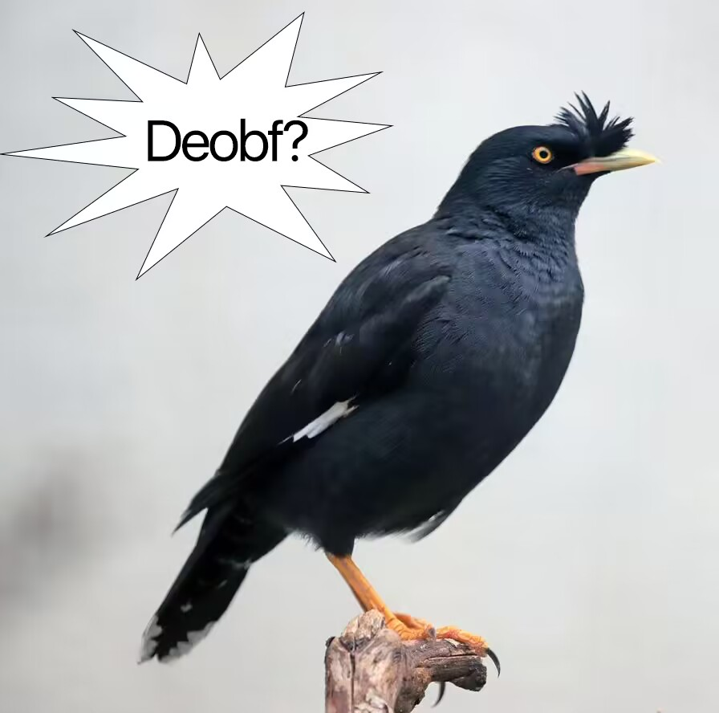

<p align="center">
  
  <br>
  <font size="6"><b>OpenPhoenix</b></font>
  <br>
  <font size="3">by Skid Solutions - from Refine Development</font>
</p>

---
For Refine Developers: even though some1 of yours reported me on dc for copyright, i'm not removing this vibeslopped and skidded aquacore fork.
---

<p align="center">
  <a href="https://discord.gg/AEwatvnvSf">https://discord.gg/AEwatvnvSf</a>
</p>

<p align="center">
  
  
  
  
</p>

---

## How to build

### Prerequisites
- **Java Development Kit**: JDK 17 (the Gradle wrapper 8.14.3 does not run on newer JDKs)

---

### Building Phoenix

Run from this folder:

```powershell
$env:JAVA_HOME = "C:\Program Files\Java\jdk-17"

.\gradlew.bat clean build
```

The build also compiles every NMS adapter listed in `platforms/versions.txt`.

Generated `build/libs/`:
- `Phoenix-3.1-34677f1.jar`
- `Phoenix-3.1-34677f1-sources.jar`
